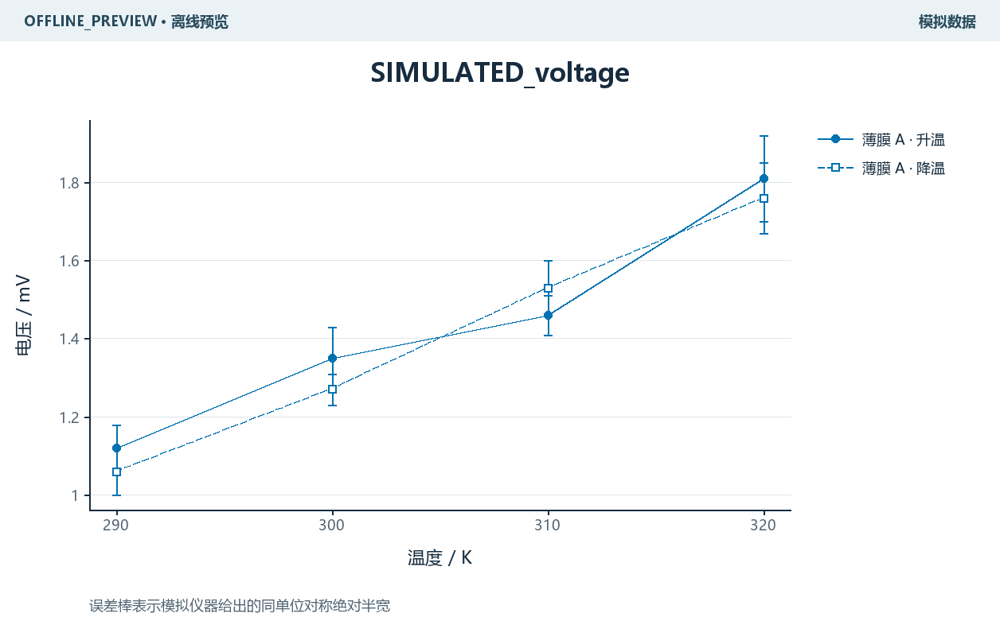
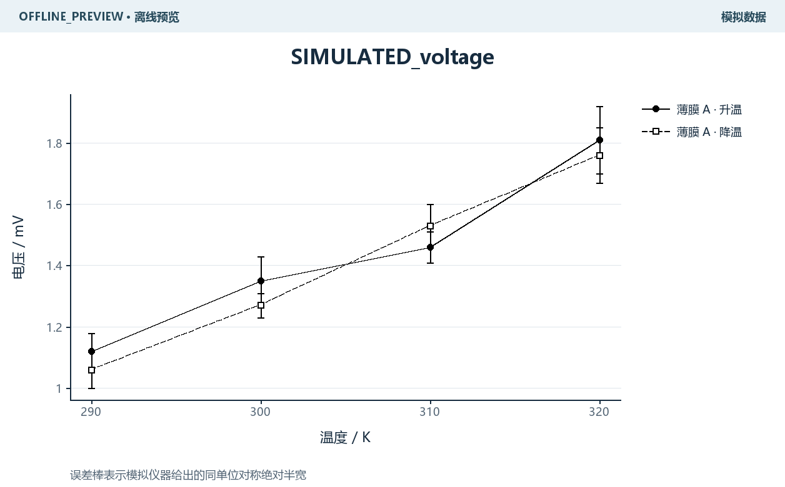
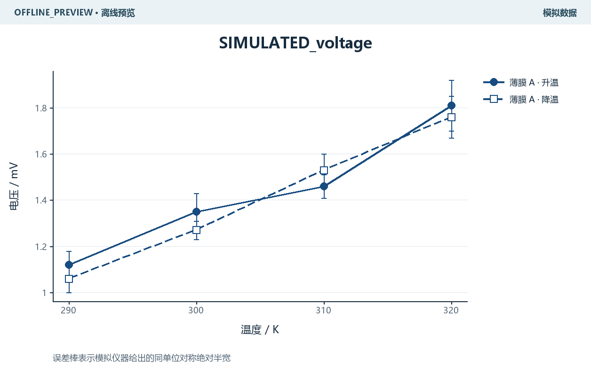

# Origin scientific plotting skill · offline Alpha

[简体中文](README.zh-CN.md) · **v0.1.0-alpha.1** · [MIT License](LICENSE)

Turn one UTF-8 CSV into a traceable plot plan and a static PNG of two series with symmetric Y error bars. Specify the columns, units and each point's absolute error half-width. The preview preserves acquisition order and repeated X values. Save and pin local style revisions for later use.

This offline Alpha runs without Origin. It ships without an Origin execution connector and cannot create editable OPJU projects or export through Origin. `--visibility managed` records each curve and its error bars as a pair in the plan. The PNG is static and displays both series. [Capabilities](docs/capabilities.md)

## Preview gallery

All three PNGs use the same **simulated** heating and cooling data for Film A. [Styles and reproducibility](docs/styles.md)

| Clean (`clean`) | Monochrome (`mono`) | Presentation (`汇报`) |
| --- | --- | --- |
|  |  |  |

## Your first preview in PowerShell

Use Windows x64, CPython 3.12 x64, Pillow 12.3.0 and local regular and bold fonts that cover the labels. Extract the ZIP to a fresh, writable directory and run the three blocks in the same PowerShell session from the directory containing this README. The initial Pillow download requires network access unless the wheel is available locally. [Dependencies](docs/dependencies.md)

**1. Select Python and install the pinned wheel.** If `python` selects another version, set `$Python312` to the full path of your chosen executable. The environment is local to this checkout.

```powershell
$Python312 = 'python'  # Select your installed 64-bit CPython 3.12 executable.
& $Python312 -c "import struct,sys; assert sys.implementation.name=='cpython' and sys.version_info[:2]==(3,12) and struct.calcsize('P')==8, sys.version"
if ($LASTEXITCODE) { throw 'Select a 64-bit CPython 3.12 executable in $Python312.' }
& $Python312 -m venv .venv
if ($LASTEXITCODE) { throw 'venv failed' }
$py = (Resolve-Path '.venv/Scripts/python.exe').Path
& $py -I -m pip --isolated install --only-binary=:all: --require-hashes -r requirements.txt
if ($LASTEXITCODE) { throw 'Pillow installation failed' }
```

For a disconnected workstation, obtain the [exact Windows wheel](https://pypi.org/project/pillow/12.3.0/#files) on another computer, keep it in a local wheelhouse, and replace the pip install command with `& $py -I -m pip --isolated install --no-index --find-links ./wheelhouse --only-binary=:all: --require-hashes -r requirements.txt`.

**2. Check the environment and inspect the bundled CSV.** Look for `OFFLINE_READY` and 8 data rows. Doctor reads the selected environment and reports any missing fonts. Font selection is described below.

```powershell
[Console]::OutputEncoding = [Text.UTF8Encoding]::new($false)
$skill = '.agents/skills/origin-alpha'
$entry = "$skill/scripts/origin_trial.py"
& $py -I -B -X utf8 $entry doctor
if ($LASTEXITCODE) { throw 'Check the doctor output' }
& $py -I -B -X utf8 $entry inspect "$skill/examples/SIMULATED_voltage.csv"
if ($LASTEXITCODE) { throw 'CSV inspection failed' }
```

**3. Render and open the PNG.** This example selects both stages, temperature in K, voltage in mV and the same-row instrument half-width. The helper passes the reviewed source hash and the clean profile to the regular draft command.

```powershell
$receipt = & $py -I -B -X utf8 tools/first_preview.py | ConvertFrom-Json
if ($LASTEXITCODE) { throw 'Preview failed' }
$receipt.previews[0]
Invoke-Item -LiteralPath $receipt.previews[0]
```

The PNG shows heating as a solid line with filled points and cooling as a dashed line with open points. The two readings at 320 K belong to separate stages. Each draft has its own directory inside `.origin-alpha/drafts/`, containing the task, compiled plan, style snapshot, source record and PNG. Verified replay requires the original CSV.

## Fonts and configuration

For a machine with suitable installed Microsoft YaHei regular and bold fonts, the default lookup uses the system Fonts directory. Otherwise use locally obtained CJK fonts. Copy [the config example](alpha-config.example.json) to `alpha-config.local.json` and add the string fields `font_regular` and `font_bold` pointing to your regular and bold files. Relative paths are resolved beside that config. Pass `--config alpha-config.local.json` before the CLI subcommand, or after `tools/first_preview.py` in step 3. A writable `--state-dir` can override the draft and style location. The [dependency guide](docs/dependencies.md) identifies both Microsoft and openly licensed Noto sources.

## Working with your data

Run `inspect` on your CSV, then give `draft` the source SHA-256, data category, actual column names, units, grouping and uncertainty definition. Convert other forms of uncertainty to absolute half-widths in the same units as Y and document the conversion before plotting.

In a compatible agent workspace, load the bundled Skill and try this request on the simulated draft you just made.

> Change only the cooling series (`降温`) to a dotted line with open square markers. Show the revised offline PNG.

The style walkthrough shows the corresponding PowerShell commands and how to save and pin a lab style. [Skill instructions](.agents/skills/origin-alpha/SKILL.md) · [Style walkthrough](docs/styles.md)

Drafts can contain measured values and absolute source paths. Keep drafts and real data in a private local directory. Use the bundled simulated CSV or a shareable redacted example for public feedback. [Security reporting](SECURITY.md)

## Roadmap and feedback

Independent first-run feedback and trials with authorized real or de-identified data are pending. A future Origin connector would require its own rights review and validation. [Trial cards](docs/trials.md) · [Validation scope](docs/validation.md)

- [Preserve heating and cooling order](docs/case-studies/01-order.md) · [Check error endpoints](docs/case-studies/02-error.md) · [Replay a style edition](docs/case-studies/03-style.md)
- [Run the offline tests](CONTRIBUTING.md) · [GitHub Issues](https://github.com/devilanhu-blip/origin-scientific-plotting-skill/issues) · [Third-party notices](THIRD_PARTY_NOTICES.md)
