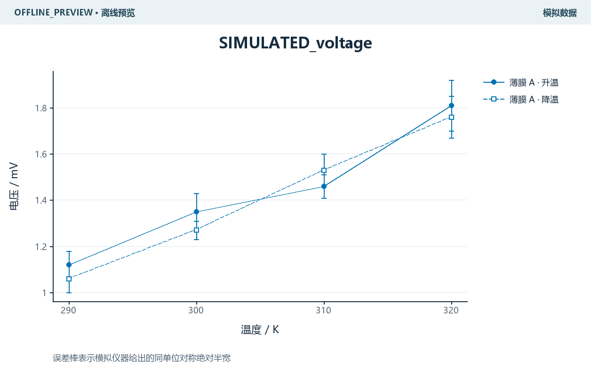
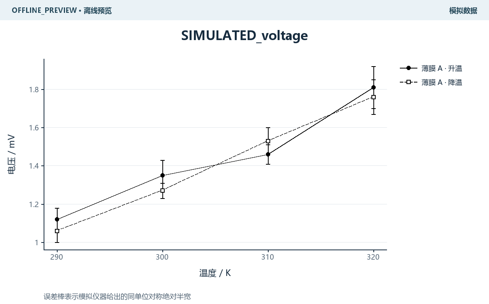
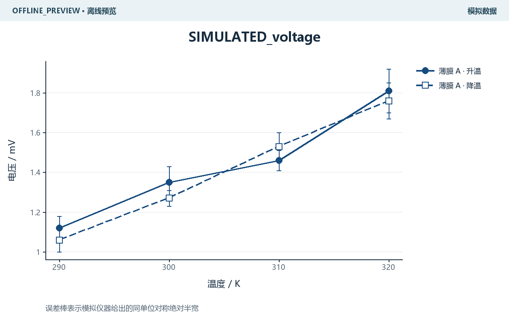

# Origin 科研绘图 Skill · 离线 Alpha

[English](README.md) · **v0.1.0-alpha.1** · [MIT 许可证](LICENSE)

从一份 UTF-8 CSV 生成可追溯的绘图计划和双系列静态 PNG。指定列名、单位和逐点绝对误差半宽，预览会绘制对称 Y 误差棒，并保留原始采集顺序和重复的 X 值。风格可保存在本机，之后可按指定版本复用。

此离线 Alpha 无需安装 Origin。包内没有 Origin 执行连接层，无法生成可编辑 OPJU 或调用 Origin 导出。`--visibility managed` 只在计划中记录曲线与误差棒的配对关系。PNG 是静态图，两组曲线同时可见。[能力范围](docs/capabilities.md)

## 样图

三张 PNG 均使用薄膜 A 的同一份**模拟**升降温数据。[风格说明与复现方法](docs/styles.md)

| 清晰（`clean`） | 单色（`mono`） | 汇报（`汇报`） |
| --- | --- | --- |
|  |  |  |

## 三步生成第一张预览

首图需要 Windows x64、CPython 3.12 x64、Pillow 12.3.0 和覆盖图中文字的本地常规及粗体字体。把 ZIP 解压到新的可写目录，从含本 README 的目录打开 PowerShell，按顺序在同一窗口运行以下三段。可以联网下载 Pillow，也可以使用已下载的 wheel 文件。[依赖说明](docs/dependencies.md)

**1. 选择 Python，创建本地虚拟环境并安装固定版本。** 如果 `python` 指向其他版本，将 `$Python312` 改为已安装 64 位 CPython 3.12 解释器的完整路径。

```powershell
$Python312 = 'python'  # Select your installed 64-bit CPython 3.12 executable.
& $Python312 -c "import struct,sys; assert sys.implementation.name=='cpython' and sys.version_info[:2]==(3,12) and struct.calcsize('P')==8, sys.version"
if ($LASTEXITCODE) { throw 'Select a 64-bit CPython 3.12 executable in $Python312.' }
& $Python312 -m venv .venv
if ($LASTEXITCODE) { throw 'venv failed' }
$py = (Resolve-Path '.venv/Scripts/python.exe').Path
& $py -I -m pip --isolated install --only-binary=:all: --require-hashes -r requirements.txt
if ($LASTEXITCODE) { throw 'Pillow installation failed' }
```

断网主机可先在另一台机器取得 [PyPI 官方 Windows 轮子](https://pypi.org/project/pillow/12.3.0/#files)，复制到本地 wheelhouse，把上面的 pip 命令换成 `& $py -I -m pip --isolated install --no-index --find-links ./wheelhouse --only-binary=:all: --require-hashes -r requirements.txt`，由依赖清单核对文件摘要。

**2. 运行只读检查，核对随包表头。** 预期 doctor 返回 `OFFLINE_READY`，inspect 返回 8 个数据行，以及温度、电压、电压绝对误差等表头。

```powershell
[Console]::OutputEncoding = [Text.UTF8Encoding]::new($false)
$skill = '.agents/skills/origin-alpha'
$entry = "$skill/scripts/origin_trial.py"
& $py -I -B -X utf8 $entry doctor
if ($LASTEXITCODE) { throw 'Check the doctor output' }
& $py -I -B -X utf8 $entry inspect "$skill/examples/SIMULATED_voltage.csv"
if ($LASTEXITCODE) { throw 'CSV inspection failed' }
```

**3. 绘制并打开预览。** 示例脚本把已核定的 CSV 摘要、阶段、单位、逐点误差定义、曲线与误差棒配对设置和清晰预设传给 `draft`。

```powershell
$receipt = & $py -I -B -X utf8 tools/first_preview.py | ConvertFrom-Json
if ($LASTEXITCODE) { throw 'Preview failed' }
$receipt.previews[0]
Invoke-Item -LiteralPath $receipt.previews[0]
```

升温是实线实心点，降温是虚线空心点。两条曲线按各自的采集顺序连线，保留 320 K 的两个转折读数。横轴单位为 K，纵轴和误差半宽的单位均为 mV。每次草稿写入 `.origin-alpha/drafts/` 下的新目录，包含任务、绘图计划、风格快照、来源记录和 PNG。复核草稿需要原 CSV。

## 字体与状态目录

默认使用系统字体目录中的微软雅黑常规和粗体。缺少中文字体时，复制[配置示例](alpha-config.example.json)为 `alpha-config.local.json`，添加 `font_regular` 和 `font_bold` 两个字符串字段，填入合法取得的本地字体文件路径；相对路径以配置文件目录为准。在第 2 步的 CLI 子命令前添加 `--config alpha-config.local.json`，在第 3 步的 `tools/first_preview.py` 后同样添加该选项。可用 `--state-dir` 单独指定草稿与风格库的可写位置。[开发机字体和开源 Noto 字体来源](docs/dependencies.md)

## 换用自己的数据

先用 `inspect` 核对 CSV，再向 `draft` 提供源文件的 SHA-256、数据类别、实际列名、单位、分组和误差定义。若使用其他形式的不确定度，先说明如何取得与 Y 同单位的逐点绝对半宽，再绘图。

在支持 Skill 的工作区加载随包 Skill 后，可以针对刚生成的模拟草稿提出这样的请求。

> 只把降温曲线改成点线和空心方块，请显示修改后的离线 PNG。

风格教程提供对应的 PowerShell 命令，也演示如何保存并固定实验室风格版本。[Skill 入口](.agents/skills/origin-alpha/SKILL.md) · [风格教程](docs/styles.md)

草稿可能包含实测值和源文件绝对路径。请把草稿和实测数据保存在私有本地目录，公开反馈时使用随包模拟 CSV 或获准分享的脱敏示例。[安全问题报告](SECURITY.md)

## 后续试用与反馈

独立用户的首次安装反馈，以及获准使用的真实或脱敏数据试用，都有待开展。如果将来开发 Origin 连接层，需要单独确认权利和验收。[试用记录卡](docs/trials.md) · [验证范围](docs/validation.md)

- [案例一：保留升降温顺序](docs/case-studies/01-order.md) · [案例二：复算误差棒端点](docs/case-studies/02-error.md) · [案例三：复用旧版风格](docs/case-studies/03-style.md)
- [运行离线测试](CONTRIBUTING.md) · [GitHub Issues](https://github.com/devilanhu-blip/origin-scientific-plotting-skill/issues) · [第三方资源声明](THIRD_PARTY_NOTICES.md)
