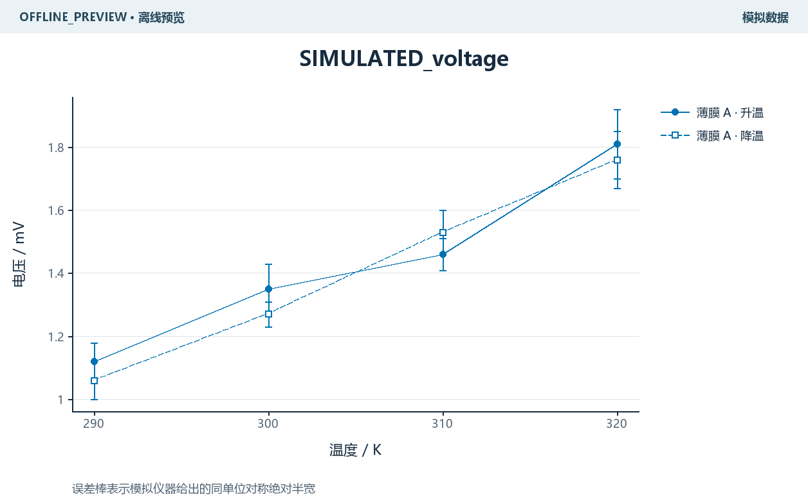

# 选择、修改和复用风格

`presets` 列出当前工作区的风格。三个内置名称可直接传给 `--preset`。下图均由 Alpha 命令行生成，状态为 `OFFLINE_PREVIEW`，使用同一份 [SIMULATED 电压数据](../.agents/skills/origin-alpha/examples/SIMULATED_voltage.csv)。历史实机能力见[验收范围](validation.md)。

| `--preset` 选项 | 本示例颜色 | 计划线宽 / 点径 | 预览 |
| --- | --- | --- | --- |
| `clean`（清晰） | 蓝 `#0072B2` | 1.1 / 5 | [清晰](gallery/SIMULATED-clean-offline-preview.png) |
| `mono`（单色） | 黑 `#000000` | 1.1 / 5 | [单色](gallery/SIMULATED-mono-offline-preview.png) |
| `汇报` | 深蓝 `#174C80` | 2 / 8 | [汇报](gallery/SIMULATED-presentation-offline-preview.png) |



升温为实线和实心圆点，降温为虚线和空心点。画廊对三种风格统一指定了降温方点。图例位于右侧。两段来自同一个样品，所以在每张图中共用颜色。表中的线宽和点径是计划参数，预览渲染为屏幕像素。

[画廊快照](gallery/snapshots.json)收录每张图的完整 `plan.json`、`style.json` 和图像摘要。三张图的 `science_digest` 一致。升温取原表数据行 1–4，降温取 5–8。温度为 K，电压与对称绝对 Y 半宽均为 mV，逐行误差量来自模拟表。三种外观沿用同一数据、单位、误差定义、源行顺序和科学计划。可从仓库根目录重新生成画廊，目标目录需是新目录。

```powershell
.\.venv\Scripts\python.exe -B -X utf8 tests/render_gallery.py .origin-alpha/gallery-rerun
```

字体及其版本可能影响重跑 PNG 的像素；用最终计划和风格快照比较数据与外观参数。此画廊使用 Windows 微软雅黑渲染。

## 从自然语言修改一条曲线

> 这份模拟草稿里，只把降温段改为点线和空心方块。其他曲线和误差安排保持当前版本。请显示改后的离线预览。

下面在 PowerShell 中从仓库根目录复现，使用首图教程创建的虚拟环境。每次调用成功后才读取其 JSON。`--state-dir` 指定本次使用的工作区，实验室风格会保存在该工作区的本地库中。使用自选字体时，在命令里的 `$entry` 后加上 `--config alpha-config.local.json`。

```powershell
$skill = '.agents/skills/origin-alpha'
$entry = "$skill/scripts/origin_trial.py"
$csv = "$skill/examples/SIMULATED_voltage.csv"
$state = '.origin-alpha/style-demo'

$py = (Resolve-Path '.venv/Scripts/python.exe').Path
function Invoke-OriginAlpha {
  $output = & $py -I -B -X utf8 $entry --state-dir $state @args
  if ($LASTEXITCODE -ne 0) { throw 'Origin Alpha 命令执行失败。' }
  $output | ConvertFrom-Json
}

(Invoke-OriginAlpha presets).presets
$info = Invoke-OriginAlpha inspect $csv
$data = @(
  '--data-kind', 'SIMULATED', '--group-by', '样品', '--sample', '薄膜 A',
  '--branch-by', '阶段', '--x', '温度 [K]', '--y', '电压 [mV]',
  '--y-error', '电压 [mV]', '电压绝对误差 [mV]', '模拟仪器给出的同单位对称绝对半宽',
  '--error-format', 'absolute-half-width', '--visibility', 'managed',
  '--kind', 'linesymbol', '--expected-sha256', $info.sha256
)
$first = Invoke-OriginAlpha draft $csv @data --preset clean
$revised = Invoke-OriginAlpha draft $first.draft --visibility managed `
  --segment '降温' line dot --segment '降温' symbol square --segment '降温' fill open
(Invoke-OriginAlpha preview $revised.draft --visibility managed).summary
$revised.previews[0]
```

打开最后返回的 PNG，核对图例、点线与空心方点。`plan.json` 记录源摘要、选列、值、单位、行区间及误差定义，`style.json` 记录当时所用的外观。修改后产生新的草稿目录。需改选列、单位或误差定义时，从 CSV 开一份新草稿。

## 保存第 1 版、追加第 2 版并固定第 1 版

```powershell
(Invoke-OriginAlpha save-style $revised.draft '实验室/热循环').selector
$next = Invoke-OriginAlpha draft $revised.draft --visibility managed --segment '降温' line dash
(Invoke-OriginAlpha save-style $next.draft '实验室/热循环' --update-from 1).selector
(Invoke-OriginAlpha history '实验室/热循环').versions
$pinned = Invoke-OriginAlpha draft $csv @data --preset '实验室#1/热循环'
$latest = Invoke-OriginAlpha draft $csv @data --preset '实验室/热循环'
```

`$pinned` 的降温曲线使用第 1 版点线，`$latest` 使用第 2 版虚线。复用其他 CSV 时，根据实际材料重新指定列、单位与误差。保存当前风格时提供当前版本号，工作区已出现新版时先查询 `history` 再更新。要重做此演示，选择新的本地 `$state` 目录。

当前风格设置覆盖颜色、线型、线宽、点形、点径、填充及图例安排。统一字体与字号、轴刻度、网格、误差端帽、毫米版心及多面板主题属于后续待评估范围。
